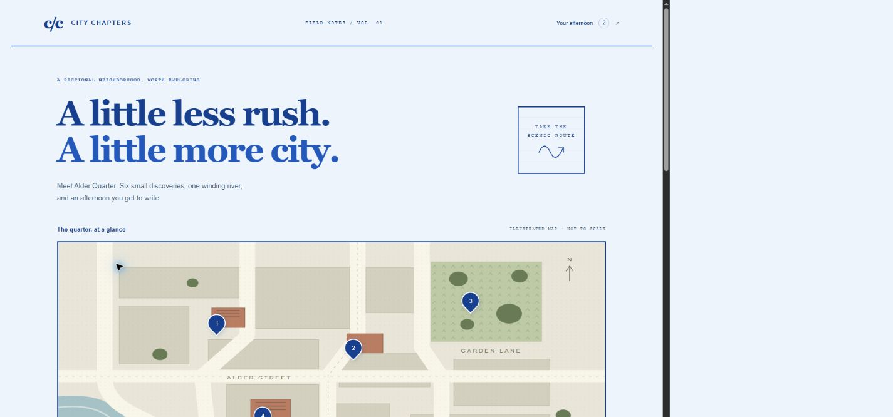
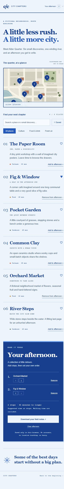

# City Chapters

An original, illustrated neighborhood explorer for an afternoon with room to wander. Alder Quarter is entirely fictional: six small places, an SVG street map, and a personal itinerary that stays in your browser.



## Explore

- Original architectural SVG illustration with numbered, keyboard-operable map pins and an equivalent semantic place list.
- Combined category, text-search and saved-place filters, with a useful empty state.
- Favorites and an ordered afternoon itinerary, persisted locally when browser storage is available.
- Accessible buttons to move stops earlier or later and remove them.
- Plain-text field notes export including the chosen order and total suggested time at stops.
- Responsive notebook layout, visible keyboard focus, live status announcements and reduced-motion support.

## Run locally

Requires Node.js 20 or newer. This project has **zero runtime and development dependencies** and makes no external API, font, analytics or asset requests. No install step is necessary.

```sh
node scripts/serve.mjs
# Open http://127.0.0.1:4173
node --test
node scripts/build.mjs
```

With npm available, `npm run dev`, `npm test` and `npm run build` are equivalent. `package-lock.json` records the dependency-free package. Set `PORT` to select another local port. The build outputs `dist/`, which can be served by any static HTTP host.

## Architecture

`index.html` contains the semantic page and hand-drawn SVG. `style.css` implements the pale-blue and cobalt atlas palette with responsive layouts. `core.js` owns demo data, composed filters, persistence validation, immutable ordering and export formatting. `app.js` handles DOM rendering and browser-only state. Native Node scripts serve and build the static application; tests use the built-in Node test runner.

Storage reads/writes are guarded. Persisted identifiers are validated against current demo data. Browser storage failures leave the current visit usable and failed writes produce a visible notice. Application text is fixed original demo content; search input is never inserted into HTML.

## Verification

Six automated tests cover combined filters, empty favorites, malformed storage, ordering boundaries and immutability, export order/time, and map data integrity. Run `node --test` for current results. Desktop and phone screenshots are in `screenshots/`; visual verification is documented in the delivery report.



## Scope and limitations

All names, places, descriptions and artwork are original fictional demo material. This is not a travel guide, a routing engine or real business information. Times are editorial suggestions for time spent at stops; walking distances and travel times are not calculated. The map is schematic and not to scale. There are no accounts, location permissions, payments, analytics, reservations or backend transmission. Saved state belongs to one browser and can be removed through its site-data controls. Clearing an afternoon preserves favorites.

No third-party dependency packages exist to audit. No open-source license has been selected; no LICENSE file is included.


Detailed executed checks and verification limits: [QA record](QA.md).
